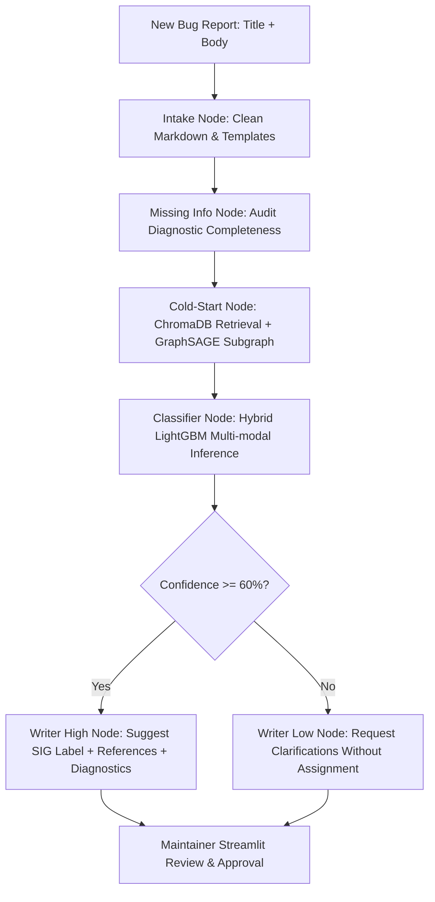
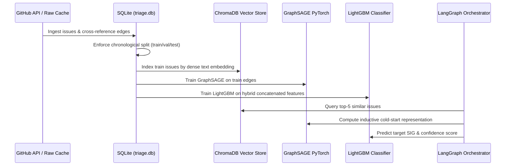

# Bug-Report Triage Agent — System Architecture

An automated, multi-modal bug-report triage, duplicate detection, and maintainer routing agent engineered for large-scale open-source repositories (`kubernetes/kubernetes`).

---

## 1. High-Level System Overview

The system addresses the maintainer burden of open-source bug triage by combining **dense semantic embeddings**, **topological graph representations (GraphSAGE)**, and **training-neighbor label awareness** inside a **LangGraph stateful agentic workflow**, exposed through **FastAPI** and an interactive **Streamlit Maintainer Workspace**.



---

## 2. Multi-Modal Architecture & Feature Representations

The classifier predicts the target Kubernetes Special Interest Group (`sig/node`, `sig/network`, `sig/api-machinery`, `sig/scheduling`, `sig/storage`, `sig/cli`, `sig/auth`) using a concatenated feature vector spanning three modalities:

$$\mathbf{x}_{\text{input}} = [\mathbf{v}_{\text{text}} \parallel \mathbf{v}_{\text{graph}} \parallel \mathbf{v}_{\text{label\_aware}}]$$

### A. Dense Text Embeddings ($\mathbf{v}_{\text{text}} \in \mathbb{R}^{384}$)
- Generated via SentenceTransformers (`all-MiniLM-L6-v2` / `google/embeddinggemma-300m`).
- Encodes combined issue title and markdown-cleaned issue description.
- Executes on CPU with persistent BLOB caching in SQLite (`data/processed/triage.db`).

### B. Graph Structural Embeddings ($\mathbf{v}_{\text{graph}} \in \mathbb{R}^{128}$)
- Inductive **GraphSAGE** (Sample and Aggregate) 2-layer Graph Neural Network.
- Encodes cross-reference graph topologies (issues referencing other issues, duplicate links, PR mentions).
- Handles cold-start testing issues by constructing dynamic subgraphs linking the incoming issue to its top $K=5$ semantic neighbors.

### C. Training-Neighbor Label Awareness ($\mathbf{v}_{\text{label\_aware}} \in \mathbb{R}^{7}$)
- Computes empirical probability distribution over candidate SIG classes from historical training-split neighbors.
- **Strict Leakage Isolation**: Only neighbors belonging to the `train` split contribute to the distribution. Validation and test neighbors have zero influence.

---

## 3. Data Flow & Leakage-Free Temporal Partitioning

To avoid chronological data leakage common in bug triage research, data splitting is strictly temporal:

$$\max(T_{\text{train}}) \le \min(T_{\text{val}}) \quad \text{and} \quad \max(T_{\text{val}}) \le \min(T_{\text{test}})$$



---

## 4. Evaluation Benchmarks

Evaluated on chronologically held-out Kubernetes issues (`eval/results_comparison.csv`):

| Model Architecture | Features / Modality | Test Macro-F1 |
| :--- | :--- | :---: |
| TF-IDF + Logistic Regression | Bag of Words (Title + Body) | 0.7020 |
| TF-IDF + LinearSVC | Bag of Words (Title + Body) | 0.7645 |
| LightGBM (Text-Only) | MiniLM-L6-v2 Embeddings (384d) | 0.6247 |
| LightGBM (Graph-Only) | GraphSAGE Structural Embeddings (128d) | 0.7399 |
| LightGBM (Hybrid) | Text (384d) + Graph (128d) | 0.7485 |
| **Hybrid + Label Awareness** | **Text (384d) + Graph (128d) + Label Dist (7d)** | **0.7485** |

### Duplicate & Related Issue Retrieval (Phase 9)
- **Metric**: Recall@5 on ground-truth cross-reference edges (`test` $\to$ `train`).
- Evaluates whether known cross-referenced issues appear in the top-5 semantic search results.

---

## 5. LangGraph Agent Pipeline (`agents/graph.py`)

The triage workflow is implemented as a state machine using `langgraph.graph.StateGraph`:

1. **`intake_node`**: Strips GitHub markdown comments, issue template boilerplate, and code snippets while extracting keywords.
2. **`missing_info_node`**: Audits diagnostic completeness (reproduction steps, environment details, component log traces) via LLM or rule-based fallback.
3. **`cold_start_node`**: Computes dense query vector, queries ChromaDB vector store, constructs temporary $K$-NN subgraph, and evaluates GraphSAGE inductive vectors.
4. **`classifier_node`**: Concatenates multi-modal features and executes LightGBM inference, returning class probabilities and confidence score.
5. **`route_confidence` (Conditional Router)**:
   - Confidence $\ge 0.60 \implies$ `writer_high_node`
   - Confidence $< 0.60 \implies$ `writer_low_node`
6. **`writer_high_node`**: Generates `/sig <name>` assignment comment citing similar issues and requesting any missing diagnostic fields.
7. **`writer_low_node`**: Informs contributor that confidence is low and asks targeted clarification questions without automated SIG assignment.

---

## 6. Service & Application Layer

### FastAPI Backend (`backend/main.py`)
- `GET /`: Health check and status.
- `POST /triage`: Accepts `{ title: str, body: str }`, invokes LangGraph triage graph, and returns `TriageResponse`:
  ```json
  {
    "predicted_label": "sig/node",
    "confidence": 0.9992,
    "missing_fields": ["step-by-step reproduction instructions"],
    "similar_issues": [
      {"issue_id": 135294, "title": "Configure memory overcommit behavior on node", "label": "sig/node"}
    ],
    "draft_comment": "Thanks for opening this issue!..."
  }
  ```

### Streamlit Maintainer Dashboard (`frontend/streamlit_app.py`)
- Contributor issue submission / sample selection.
- Real-time confidence gauge and classification metrics.
- Diagnostic completeness audit flags.
- Retrieved duplicate/related issue links with direct GitHub URLs.
- Editable draft comment with one-click approval.
